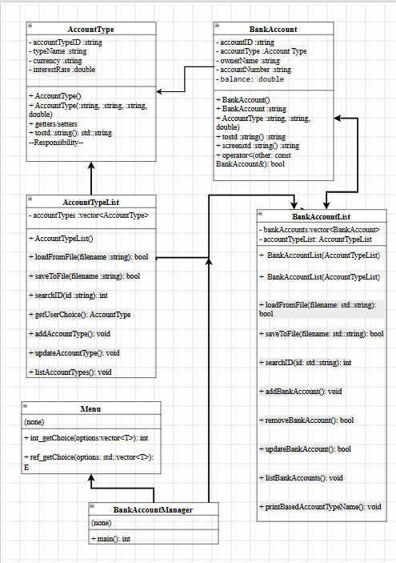

# BankAccountPrj: Hệ thống quản lý tài khoản ngân hàng

Bài tập lớn môn **Lập trình C++ (INT1339)**, lớp D26TXCN01-K, Học viện Công nghệ Bưu chính Viễn thông.
**Nhóm 7, Topic 09: Bank Account Management System.**

Ứng dụng C++ chạy trên console, quản lý hai danh mục:

- **AccountType**: loại tài khoản, gồm mã, tên loại, tiền tệ, lãi suất.
- **BankAccount**: tài khoản ngân hàng, gồm mã, loại tài khoản, chủ tài khoản, số tài khoản, số dư.

Mỗi BankAccount thuộc đúng một AccountType. Dữ liệu nằm trong hai tệp văn bản. Chương trình nạp hai tệp này khi khởi động và chỉ ghi ra tệp khi người dùng chọn lưu.

## Chức năng

| # | Menu | Mô tả |
|---|---|---|
| 1 | List all AccountTypes | Hiển thị toàn bộ loại tài khoản |
| 2 | Add a new AccountType | Thêm loại mới, kiểm tra trùng mã, trường rỗng, lãi suất > 0 |
| 3 | Search AccountType by ID | Tìm loại theo mã |
| 4 | Update AccountType | Sửa loại theo mã; các tài khoản đang dùng loại đó được cập nhật theo |
| 5 | Save AccountTypes to accounttypes.txt | Ghi danh sách loại ra tệp |
| 6 | List all BankAccounts sorted by typeName | Hiển thị tài khoản theo tên loại, trùng tên loại thì theo mã |
| 7 | Search BankAccounts by partial typeName | Lọc tài khoản theo một phần tên loại |
| 8 | Add a new BankAccount | Thêm tài khoản, chọn loại từ danh sách |
| 9 | Remove BankAccount by ID | Xoá tài khoản theo mã |
| 10 | Update BankAccount by ID | Sửa tài khoản, kiểm tra ràng buộc |
| 11 | Save BankAccounts to bankaccounts.txt | Ghi danh sách tài khoản ra tệp |
| 12 | Deposit money *(mở rộng)* | Nạp tiền (số tiền > 0) |
| 13 | Withdraw money *(mở rộng)* | Rút tiền, không vượt quá số dư |
| 14 | Show yearly interest *(mở rộng)* | Tiền lãi một năm = số dư × lãi suất |
| 0 | Exit | Thoát. **Không tự ghi đè dữ liệu**; nếu còn thay đổi chưa lưu thì hỏi lại |

**Ràng buộc dữ liệu:**

- Mã không được rỗng hoặc trùng.
- Tên, tiền tệ, chủ tài khoản, số tài khoản không được rỗng.
- `interestRate > 0`, `balance ≥ 0`.
- Loại tài khoản của một tài khoản phải tồn tại.

Nhập sai thì chương trình bắt nhập lại. Chọn menu sai, kể cả nhập chữ, không làm dừng chương trình.

## Build và chạy

**Dev-C++ 6.3 (TDM-GCC 9.2):** mở `BankAccountPrj.dev` rồi nhấn **F11** (Compile & Run).

**g++ (C++11 trở lên):**

```bash
g++ -std=c++11 -Wall -o BankAccountPrj *.cpp
./BankAccountPrj
```

**CMake:**

```bash
cmake -S . -B build
cmake --build build
```

Hai tệp `accounttypes.txt` và `bankaccounts.txt` phải nằm **trong thư mục chạy chương trình**. Nếu thiếu tệp, chương trình báo lỗi và bắt đầu với danh sách rỗng.

## Định dạng tệp dữ liệu

Mỗi dòng là một bản ghi. Dòng trống, dòng bắt đầu bằng `#` và dòng tiêu đề được bỏ qua. Các trường cách nhau bằng dấu `,` (theo đề); chương trình cũng đọc được dấu `|`.

`accounttypes.txt`: `accountTypeID, typeName, currency, interestRate`

```
T01, Savings, VND, 0.045
T02, Checking, VND, 0.001
T03, Student, VND, 0.015
```

`bankaccounts.txt`: `accountID, accountType, ownerName, accountNumber, balance`

```
A01, T01, Nguyen An, AC10001, 12000000
A02, T02, Tran Binh, AC10002, 3000000
A03, T03, Le Chi, AC10003, 800000
```

`interestRate` là tỷ lệ: `0.045` nghĩa là 4,5%/năm.

Khi nạp tệp, dòng sai định dạng, dòng có số không hợp lệ, mã trùng hoặc loại tài khoản không tồn tại sẽ bị bỏ qua, kèm thông báo số dòng và lý do.

## Cấu trúc mã nguồn

| Tệp | Class | Vai trò |
|---|---|---|
| `main.cpp` | | Tạo `BankAccountManager` rồi gọi `run()` |
| `BankAccountManager.h/.cpp` | `BankAccountManager` | Nạp dữ liệu, vòng lặp menu, gọi từng chức năng |
| `AccountType.h/.cpp` | `AccountType` | Một loại tài khoản |
| `AccountTypeList.h/.cpp` | `AccountTypeList` | `std::vector<AccountType>`: đọc/ghi tệp, tìm, thêm, sửa |
| `BankAccount.h/.cpp` | `BankAccount` | Một tài khoản (liên kết tới một `AccountType`) |
| `BankAccountList.h/.cpp` | `BankAccountList` | `std::vector<BankAccount>` sắp xếp theo typeName rồi accountID: đọc/ghi tệp, tìm, thêm, xoá, sửa |
| `Menu.h/.cpp`, `Utils.h` | `Menu` | Hiển thị lựa chọn, nhập liệu an toàn |
| `DataFile.h` | | Tách dòng dữ liệu và kiểm tra lỗi khi nạp tệp |
| `docs/` | | UML Class Diagram của Hanh (`.png`); bản nháp của Khôi trong `docs/ban-nhap-khoi/` |



*UML Class Diagram – Vũ Trọng Hanh (K26DTCN089), gửi nhóm ngày 19/11/2026.*

## Thành viên

| Họ tên | MSSV | Phụ trách chính |
|---|---|---|
| Vũ Đăng Khôi (nhóm trưởng) | K26DTCN100 | Điều phối; `BankAccountManager`, kiểm tra lỗi nạp tệp, CN 10, chức năng mở rộng |
| Vũ Trọng Hanh | K26DTCN089 | Phân tích, UML; CN 2–4 |
| Nguyễn Quốc Khánh | K26DTCN019 | `AccountType`; CN 1, 5 |
| Nguyễn Thanh Phong | K26DTCN107 | `BankAccount`; CN 6 |
| Ngô Đình Tài | K26DTCN028 | CN 8–9 |
| Lương Đức Trung | K26DTCN115 | `Menu`, nhập liệu an toàn, dữ liệu mẫu, tổng hợp kiểm thử |
| Nguyễn Thành Đạt (thư ký) | K26DTCN008 | CN 7, 11; biên bản, báo cáo, slide |

Giảng viên hướng dẫn: Mai Ngọc Lương.

## Tài liệu dự án

| Thư mục | Nội dung |
|---|---|
| [`tai-lieu/de-bai/`](tai-lieu/de-bai/) | Đề Topic 09 (yêu cầu, ràng buộc, UML gợi ý, 12 test case, sản phẩm phải nộp) |
| [`tai-lieu/ke-hoach/`](tai-lieu/ke-hoach/) | Kế hoạch và yêu cầu từng giai đoạn, quy chuẩn code (`Nhom_7_Ke_hoach_Yeu_cau_Giai_doan.docx`), `Nhom_7_Plan.xlsx` |
| [`tai-lieu/phan-tich/`](tai-lieu/phan-tich/) | Tài liệu phân tích yêu cầu (GĐ1) |
| [`tai-lieu/bieu-mau/`](tai-lieu/bieu-mau/) | Mẫu phiếu báo cáo tiến độ, biên bản họp, báo cáo, slide |
| [`docs/`](docs/) | UML Class Diagram của Hanh (`.png` để chèn báo cáo). Bản nháp của Khôi (`.png`, `.drawio`, `.svg`) ở [`docs/ban-nhap-khoi/`](docs/ban-nhap-khoi/) |
| [`TIEN-DO.md`](TIEN-DO.md) | Bảng theo dõi tiến độ của cả nhóm |

Bản đang soạn của báo cáo, slide và biên bản vẫn để trên **Google Drive của nhóm** cho mọi người cùng sửa. Thư mục `tai-lieu/` chỉ chứa bản chụp lại để tra cứu nhanh; khi có bản chốt thì đẩy bản mới lên thay.

## Theo dõi tiến độ

Mọi việc của nhóm nằm trong **[TIEN-DO.md](TIEN-DO.md)**: mỗi việc có người làm, người duyệt, hạn và trạng thái.

| Ký hiệu | Nghĩa |
|---|---|
| ✅ | Xong (đã duyệt hoặc đã gộp vào `main`) |
| 👀 | Làm xong, đang chờ review/duyệt |
| 🔄 | Đang làm |
| ⏳ | Chưa tới hạn |
| ⚠️ | Quá hạn: báo nhóm trưởng trên Zalo |

**Xem tiến độ:** mở [TIEN-DO.md](TIEN-DO.md) trên GitHub. Muốn biết việc của mình thì tìm tên mình trong cột "Người làm".

**Cập nhật trạng thái** (mỗi người tự sửa dòng của mình, làm được ngay trên trình duyệt):

1. Mở [TIEN-DO.md](TIEN-DO.md) và bấm biểu tượng **bút chì ✏️** (Edit this file) ở góc phải.
2. Sửa cột **Trạng thái** của việc mình, ví dụ `🔄` thành `👀`. Ở cột "Sản phẩm / ghi chú", ghi link PR hoặc tên file.
3. Thêm một dòng vào **Nhật ký cập nhật** ở cuối file: `| ngày | tên | đã làm gì |`.
4. Bấm **Commit changes…**, ghi message dạng `[Ten] Cap nhat tien do`, chọn **Commit directly to the `main` branch**, rồi bấm Commit.

   Riêng file `TIEN-DO.md` được sửa thẳng trên `main`; code vẫn phải đi qua Pull Request.

**Khi nào cập nhật:**

- Mỗi khi xong hoặc bắt đầu một việc.
- **Bắt buộc** trước mỗi kỳ báo cáo: **22/11** (trước họp lần 2) và **28/11** (trước họp lần 3), cùng lúc gửi phiếu báo cáo tiến độ (mẫu ở `tai-lieu/bieu-mau/`).

**Theo dõi code:**

- Tab **[Pull requests](https://github.com/ZoLoMario/09BAMS/pulls)** là danh sách code đang chờ review.
- Nếu được nhờ review, GitHub gửi thông báo vào email. Danh sách việc cần review của mình nằm ở [github.com/pulls/review-requested](https://github.com/pulls/review-requested).
- Bấm **Watch → All Activity** ở đầu repo để nhận thông báo mỗi khi có PR mới hoặc có người sửa tiến độ.

**Nhóm trưởng** rà lại [TIEN-DO.md](TIEN-DO.md) trước mỗi buổi họp và ghi những việc trễ vào biên bản.

## Quy trình làm việc

- Mỗi người làm trên **nhánh riêng**, đặt tên `ten-chucnang`, ví dụ `khanh-accounttype`.
- Commit message theo mẫu `[Ten] Mo ta ngan`.
- Gộp vào `main` qua **Pull Request** sau khi người review chéo duyệt. Vòng review: Khánh→Hanh→Phong→Đạt→Tài→Khôi→Trung→Khánh.
- Đầu mỗi tệp và mỗi hàm có comment ghi MSSV, người viết, ngày viết, người duyệt, ngày duyệt, kết quả duyệt.
- Không đưa tệp build (`*.o`, `*.exe`) lên repo; `.gitignore` đã chặn các tệp này.

## Giấy phép

Phát hành theo giấy phép [MIT](LICENSE).
